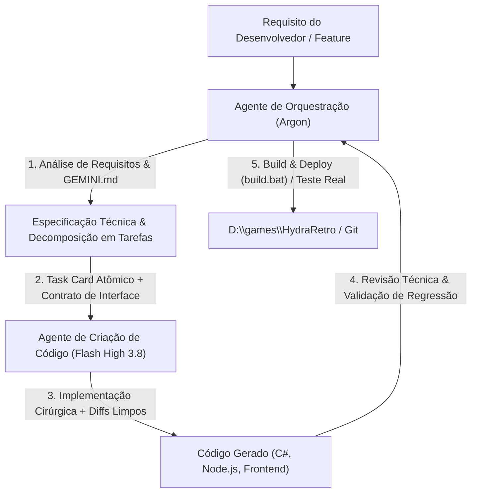

# 🎮 HydraRetro — Diretrizes, Especificações e Contexto do Projeto


Este documento reúne todas as diretrizes técnicas, arquiteturais e operacionais do **HydraRetro** para garantir consistência e alinhamento em todas as sessões de desenvolvimento.


---


## 📌 1. Visão Geral do Projeto


O **HydraRetro** é um catálogo fullscreen leve, ágil e visualmente rico, projetado para consolidar consoles retrô (foco inicial: **PlayStation 1** e **Sega Mega Drive**) e ser iniciado a partir de um único atalho na biblioteca do **Hydra Launcher**.


### Principais Pilares:

- **Zero Configuração para o Usuário Final:** Os emuladores já vêm embutidos e configurados para tela cheia e controle de Xbox (XInput).

- **Filosofia de Projeto "Cru" (Clean Distribution):** O projeto final é distribuído enxuto/cru (sem ROMs, sem BIOS e sem bases estáticas pesadas embutidas no Git). O usuário apenas adiciona seus jogos nas pastas de consoles correspondentes.

- **Auto-Scraping e Descoberta Inteligente:** Ao adicionar qualquer jogo, o sistema detecta os arquivos automaticamente e dispara a busca online em tempo real de metadados completos (sinopses originais, desenvolvedoras, publicadoras, ano de lançamento, capas, heróis, logos e avaliações) montando o catálogo visual rico sem exigir nenhuma ação manual do usuário.

- **Plug-and-Play de ROMs e BIOS:** Basta ao usuário colocar suas ROMs em `ROMS\<Console>` e a BIOS em `BIOS\` que o sistema detecta tudo automaticamente ao abrir (ou em tempo real via hot-plug).

- **Experiência Console:** Transição suave entre catálogo e jogo com minimização e restauração automática da interface.


---


## 📁 2. Estrutura de Diretórios e Ambientes


### Ambiente de Desenvolvimento (Repositório Git):

`C:\PROJETOS\HydraRetro\`


### Ambiente de Produção Local:

`D:\games\HydraRetro\`


### Estrutura Padrão:

```text

HydraRetro/

├── BIOS/                            # Pasta para BIOS (ex: SCPH1001.BIN) [Ignorada no Git, exceto .gitkeep]

│   └── .gitkeep

├── ROMS/                            # Pasta para ROMs dos consoles [Ignorada no Git, exceto .gitkeep]

│   ├── PS1/                         # .chd, .cue/.bin, .pbp, .iso

│   │   └── .gitkeep

│   ├── GENESIS/                     # .zip, .md, .gen, .bin, .7z

│   │   └── .gitkeep

│   ├── SNES/                        # .sfc, .smc, .zip, .7z

│   │   └── .gitkeep

│   ├── MAME/                        # .zip, .7z (Arcade)

│   │   └── .gitkeep

│   ├── PS2/                         # .chd, .iso, .cso, .gz

│   │   └── .gitkeep

│   ├── WII/                         # .rvz, .wbfs, .iso, .ciso

│   │   └── .gitkeep

│   ├── GC/                          # .rvz, .gcm, .iso, .ciso, .wbfs (GameCube)

│   │   └── .gitkeep

│   ├── PSP/                         # .iso, .cso, .chd, .pbp

│   │   └── .gitkeep

│   ├── PS3/                         # .iso, .pkg, .bin

│   │   └── .gitkeep

│   ├── N64/                         # .z64, .n64, .v64, .zip

│   │   └── .gitkeep

│   ├── GBA/                         # .gba, .zip

│   │   └── .gitkeep

│   ├── GBC/                         # .gbc, .zip

│   │   └── .gitkeep

│   ├── GB/                          # .gb, .zip

│   │   └── .gitkeep

│   └── SWITCH/                      # .nsp, .xci

│       └── .gitkeep

├── emulators/                       # Emuladores pré-configurados [Commitados no Git]

│   ├── duckstation/                 # DuckStation x64 Release (PS1)

│   ├── ryujinx/                     # Ryujinx x64 Portable (Nintendo Switch)

│   │   ├── Ryujinx.exe

│   │   ├── portable/

│   │   │   └── system/              # prod.keys e title.keys

│   │   └── README.txt

│   ├── pcsx2/                       # PCSX2 x64 Qt (PS2)

│   │   ├── pcsx2-qt.exe

│   │   ├── portable.txt

│   │   └── inis/PCSX2.ini

│   ├── dolphin/                     # Dolphin x64 Release (Wii e GameCube)

│   │   ├── Dolphin.exe

│   │   ├── portable.txt

│   │   └── User/Config/Dolphin.ini

│   ├── ppsspp/                      # PPSSPP x64 Release (PSP)

│   │   ├── PPSSPPWindows64.exe

│   │   └── installed.txt

│   ├── rpcs3/                       # RPCS3 x64 Release (PS3)

│   │   └── rpcs3.exe

│   └── retroarch/                   # RetroArch x64 (Mega Drive, SNES, Arcade, N64, GBA, GBC, GB)

│       ├── retroarch.exe

│       ├── retroarch.cfg            # Fullscreen + XInput Controller + Caminho da BIOS

│       ├── autoconfig/              # Perfis de controle

│       ├── cores/

│       │   ├── genesis_plus_gx_libretro.dll    # Core Mega Drive

│       │   ├── snes9x_libretro.dll             # Core Super Nintendo

│       │   ├── fbneo_libretro.dll              # Core Arcade / MAME

│       │   ├── mupen64plus_next_libretro.dll   # Core Nintendo 64

│       │   ├── mgba_libretro.dll               # Core Game Boy Advance

│       │   └── gambatte_libretro.dll           # Core Game Boy & Game Boy Color

│       └── system/

│           └── .gitkeep

├── data/

│   ├── database.json                # Banco de dados local da biblioteca escaneada [Ignorado no Git]

│   └── ps1_hydra_metadata.json      # Metadados e IDs para capas do Hydra LaunchBox

├── src/

│   ├── electron-main.js             # Entrypoint Desktop Nativo (Electron GPU-Accelerated 60/120 FPS)

│   ├── server.js                    # Backend HTTP/API local (Node.js) escutando na porta 38475

│   ├── pc_stores_engine.js          # Motor Unificado de Jogos de PC (.EXE), Steam (VDF/Web) & Epic Games (Legendary)

│   ├── Launcher.cs                  # Executável de entrada (inicia Electron Nativo ou fallback WebView GPU)

│   ├── FocusHelper.cs               # Utilitário Win32 para troca de foco, minimização e atalho Select+Start / Esc

│   └── ui/                          # Frontend SPA Virtualizado a 60/120 FPS

│       ├── index.html

│       ├── styles.css

│       └── app.js

├── build.bat                        # Script de compilação e deploy para C:\games\HydraRetro

├── .gitignore                       # Regras de exclusão do repositório

└── gemini.md                        # Este documento de referência

```


---


## 🕹️ 3. Emuladores e Configurações Padrão


### PlayStation 1 — DuckStation

- **Executável:** `emulators/duckstation/duckstation-qt-x64-ReleaseLTCG.exe`

- **Modo Portátil:** Arquivo `portable.txt` presente na raiz do DuckStation.

- **Linha de Comando:** `-batch -fullscreen -- "{ROM}"`

- **Diretório de BIOS:** Configurado em `settings.ini` como `../../BIOS` (com fallback no próprio DuckStation para BIOS HLE).

- **Controle de Xbox (Pad1):** Mapeamento via SDL-0 / XInput nativo (`settings.ini`):

  - Botão A = Cross (X)

  - Botão B = Circle (Círculo)

  - Botão X = Square (Quadrado)

  - Botão Y = Triangle (Triângulo)

  - LB / RB = L1 / R1

  - Gatilhos LT / RT = L2 / R2

  - D-Pad e Analógicos configurados

  - Teclado padrão mapeado como fallback.

- **Tratamento de Arquivos Multi-pista:** Se um jogo possuir `.cue` e `.bin` com o mesmo nome, o scanner executa e exibe apenas o `.cue`, evitando duplicações no catálogo.


### Sega Mega Drive — RetroArch (Core Genesis Plus GX)

- **Executável:** `emulators/retroarch/retroarch.exe`

- **Core:** `emulators/retroarch/cores/genesis_plus_gx_libretro.dll`

- **Linha de Comando:** `-f -L "{CORE}" "{ROM}"`

- **Configuração:** `retroarch.cfg`:

  - `video_fullscreen = "true"`

  - `input_joypad_driver = "xinput"`

  - `input_autodetect_enable = "true"`

  - Botões mapeados diretamente para controle Xbox via XInput e teclado como fallback.


### Super Nintendo — RetroArch (Core Snes9x)

- **Executável:** `emulators/retroarch/retroarch.exe`

- **Core:** `emulators/retroarch/cores/snes9x_libretro.dll`

- **Linha de Comando:** `-f -L "{CORE}" "{ROM}"`

- **Configuração:** Usa o mesmo `retroarch.cfg` compartilhado com suporte nativo a fullscreen e controle XInput.


### Arcade / MAME — RetroArch (Core FinalBurn Neo)

- **Executável:** `emulators/retroarch/retroarch.exe`

- **Core:** `emulators/retroarch/cores/fbneo_libretro.dll`

- **Linha de Comando:** `-f -L "{CORE}" "{ROM}"`

- **Configuração:** Usa o mesmo `retroarch.cfg` compartilhado. Compatível com Neo Geo, Capcom CPS1/CPS2/CPS3 e títulos clássicos MAME.


### PlayStation 2 — PCSX2 (Versão Qt x64 Portable)

- **Executável:** `emulators/pcsx2/pcsx2-qt.exe`

- **Modo Portátil:** Arquivo `portable.txt` na raiz da pasta.

- **Linha de Comando:** `-batch -fullscreen -nogui -- "{ROM}"`

- **Configuração:** `inis/PCSX2.ini`:

  - Fullscreen ativado (`StartFullscreen = true`)

  - Sem prompts de confirmação ao fechar (`ConfirmShutdown = false`)

  - Diretório de BIOS apontado para `../../BIOS`

  - Mapeamento nativo Xbox Controller (Pad1 via SDL/XInput).


### Nintendo Wii & GameCube — Dolphin Emulator (x64 Portable)

- **Executável:** `emulators/dolphin/Dolphin.exe`

- **Modo Portátil:** Arquivo `portable.txt` na raiz da pasta.

- **Linha de Comando:** `-b -e "{ROM}"`

- **Configuração:** `User/Config/Dolphin.ini` e perfis de controle `GCPadNew.ini` / `WiimoteNew.ini`:

  - Fullscreen ativado (`Fullscreen = True`)

  - Sem tela de confirmação de saída (`ConfirmStop = False`)

  - Suporte total a formatos compactados modernos (`.rvz`, `.wbfs`, `.iso`, `.gcm`).

  - Mapeamento automático de controle Xbox emulando Wiimote + Nunchuk, Classic Controller e GameCube Pad nativo.


### PlayStation Portable (PSP) — PPSSPP (x64 Portable)

- **Executável:** `emulators/ppsspp/PPSSPPWindows64.exe`

- **Modo Portátil:** Arquivo `installed.txt` na raiz da pasta.

- **Linha de Comando:** `--fullscreen "{ROM}"`

- **Configuração:** `memstick/PSP/SYSTEM/ppsspp.ini`:

  - Fullscreen ativado (`FullScreen = True`)

  - Suporte total a `.iso`, `.cso`, `.chd`, `.pbp`.

  - Mapeamento nativo Xbox Controller (XInput).


### PlayStation 3 (PS3) — RPCS3 (x64 Portable)

- **Executável:** `emulators/rpcs3/rpcs3.exe`

- **Linha de Comando:** `--no-gui "{ROM}"`

- **Configuração:** `config.yml` e `GuiConfigs/CurrentSettings.ini`:

  - Fullscreen ativado (`Start games in fullscreen mode: true`)

  - Suporte a `.iso`, `.pkg`, `.bin`, `.self`, `.eboot`.


### Nintendo 64 — RetroArch (Core Mupen64Plus-Next)

- **Executável:** `emulators/retroarch/retroarch.exe`

- **Core:** `emulators/retroarch/cores/mupen64plus_next_libretro.dll`

- **Linha de Comando:** `-f -L "{CORE}" "{ROM}"`

- **Formatos Suportados:** `.z64`, `.n64`, `.v64`, `.zip`, `.7z`.


### Game Boy Advance — RetroArch (Core mGBA)

- **Executável:** `emulators/retroarch/retroarch.exe`

- **Core:** `emulators/retroarch/cores/mgba_libretro.dll`

- **Linha de Comando:** `-f -L "{CORE}" "{ROM}"`

- **Formatos Suportados:** `.gba`, `.zip`, `.7z`.


### Game Boy & Game Boy Color — RetroArch (Core Gambatte)

- **Executável:** `emulators/retroarch/retroarch.exe`

- **Core:** `emulators/retroarch/cores/gambatte_libretro.dll`

- **Linha de Comando:** `-f -L "{CORE}" "{ROM}"`

- **Formatos Suportados:** `.gb`, `.gbc`, `.zip`, `.7z`.


### Nintendo Switch — Ryujinx (ou Ryujinx.Ava)

- **Executável:** `emulators/ryujinx/Ryujinx.exe` (com fallback automático para `Ryujinx.Ava.exe`)

- **Modo Portátil:** Subpasta `portable/` na raiz do emulador garante dados isolados sem tocar no AppData.

- **Linha de Comando:** `--fullscreen "{ROM}"`

- **Formatos Suportados:** `.nsp`, `.xci`.

- **Chaves & Firmware:** Arquivo `prod.keys` em `emulators/ryujinx/portable/system/` (ou `BIOS/switch/`) e Firmware oficial instalado via interface gráfica do Ryujinx (*Tools -> Install Firmware*).

- **Mapeamento:** Controle de Xbox (XInput nativo).


---


## ⚙️ 4. Arquitetura de Software e Padrões de Excelência (Playnite / Batocera Style)

1. **Launcher C# (`HydraRetro.exe`) & Gestão de Recursos:**
   - Inicia o processo Node em segundo plano (`server.js`) caso a porta `38475` não esteja aberta.
   - Abre o Microsoft Edge em modo app/kiosk (`--app=http://127.0.0.1:38475 --start-fullscreen --user-data-dir="data\webview_profile"`).
   - **Suspensão de Recursos:** Ao iniciar qualquer emulador, o launcher minimiza o WebView via `FocusHelper.exe`, reduzindo o consumo de GPU e CPU do catálogo a 0% durante a gameplay. Ao fechar o emulador, restaura a janela automaticamente, calcula o tempo da sessão e atualiza as estatísticas no banco de dados.
   - Ao fechar a janela principal do HydraRetro, encerra o processo Node.js limpo.

2. **Subpastas como Chave Primária e Auto-Bootstrap da Árvore de Diretórios:**
   - A subpasta do console (`ROMS/<Console>`) atua como chave primária de identificação da plataforma.
   - Ao iniciar pela primeira vez, o sistema gera automaticamente toda a árvore vazia de diretórios (`ROMS/`, `media/covers/`, `media/thumbs/`, `emulators/`, `data/`) orientando o usuário.
   - Monitoramento em tempo real via `fs.watch` (hot-plug de ROMs).
   - Filtro de extensões por console e deduplicação de multi-tracks (se houver `.bin` e `.cue`, indexa apenas o `.cue` ou `.chd`, nunca duplicando jogos na tela).

3. **UI Virtualization (Virtualização de Grade a 60 FPS):**
   - **Zero DOM Bloat:** Nunca instancia todos os cards da biblioteca no DOM simultaneamente. O container virtualizado renderiza dinamicamente apenas a janela visível no viewport (~20 a 40 cards) e recicla os nós via `requestAnimationFrame` conforme o scroll desce.
   - Mantém o consumo de RAM estritamente baixo (~30MB em vez de centenas de MB) com rolagem fluida e estável a 60 FPS, mesmo em bibliotecas com mais de 10.000 jogos.
   - **Pipeline de Miniaturas em WebP & Lazy Loading:** O grid carrega miniaturas otimizadas em formato `.webp` de ~20KB (`media/thumbs/<console>/`) com proporção padrão (~250x350px) em vez de jogar imagens de alta resolução na memória RAM.
   - Exibição de placeholder shimmer escuro enquanto a rolagem é rápida, carregando a textura suavemente ao parar.

4. **Fluxo de Identificação e Auto-Scraping Inteligente (Hash vs. Nome):**
   - **Identificação por Hash (CRC32):** Extração ultra-rápida do CRC32 (leitura direta do cabeçalho de arquivos `.zip` em 0.05ms ou cálculo nativo de ROMs pequenas em ~15ms; leitura de serial em cabeçalhos de ISO para PS1/PS2 sem travar o disco).
   - **Fallback por Limpeza de Regex:** Limpeza automática de sufixos de release, dumps e regiões (`(...)`, `[...]`, `_`, `[!].smc` -> `Chrono Trigger`).
   - **Scraping Multi-Fonte Gratuito:**
     * **ScreenScraper.fr (FONTE PRIMÁRIA):** Identificação oficial por hash (CRC32/MD5) e busca textual, enredo/sinopse em português brasileiro, desenvolvedora, publicadora, ano e boxarts oficiais 2D e 3D.
     * **Wikipedia (PT-BR prioritária / EN fallback):** Fallback para enredo original completo, sinopse detalhada e histórico de lançamento.
     * **HowLongToBeat (HLTB):** Avaliação da comunidade e tempo médio de conclusão da campanha (Main Story, Extra, 100%).
     * **SteamGridDB, TheGamesDB & Libretro CDN:** Capas padronizadas verticais HD (600x900), banners hero e acervo oficial Libretro por região.
   - **Background Queue Não-Bloqueante & Regra Zero-Redownload:** Ao colocar centenas de ROMs, os jogos entram instantaneamente no catálogo com capa padrão ("Zero Delay") enquanto um Background Worker com taxa suave (1.5s) vai enriquecendo e baixando capas e metadados diretamente para a pasta local `covers/`. Uma vez atribuída e salva no disco, a capa **nunca mais é baixada novamente em scans futuros** (permanece imutável). Em cada abertura do software, o scanner apenas detecta novas ROMs adicionadas e busca capas estritamente para os jogos que ainda não possuem arte atribuída.

5. **Mapeamento Embutido de Emuladores:**
   - RetroArch como motor unificado (80% dos consoles retrô via DLL de cores) e emuladores standalone para sistemas pesados (DuckStation para PS1, PCSX2 para PS2, Dolphin para Wii/GC, PPSSPP para PSP e RPCS3 para PS3).

6. **Navegação Nativa por Controle (Gamepad API) & Áudio Tátil (UI SFX):**
   - Navegação 100% pelo controle (Xbox/XInput/Gamepad padrão) com polling via `requestAnimationFrame`.
   - Mapeamento:
     * **D-Pad / Analógico:** Navegação bidimensional pelo grid virtualizado com auto-scroll e borda iluminada `.gamepad-focused`.
     * **Botão A:** Abre detalhes do jogo ou dá início direto na partida.
     * **Botão B:** Fecha o modal de capas ou painel de detalhes e volta para o catálogo.
     * **Botão X:** Início Rápido (Quick Play) diretamente do catálogo.
     * **Botão Y:** Alterna favorito instantaneamente com atualização do badge e som estelar.
     * **LB / RB:** Alterna entre abas e consoles na barra lateral.
     * **SELECT / View:** Abre o Seletor de Capas e Artes Alternativas do jogo focado.
   - **Sintetizador Web Audio API:** Gera sons de alta fidelidade e latência zero (nav, select, back, favorite, launch) sem requisições de rede ou arquivos pesados.

7. **Atalho Universal de Saída dos Emuladores (`Select + Start` / `Escape`):**
   - `FocusHelper.exe` atua como daemon de controle Win32 durante a gameplay.
   - Monitora XInput (controles 0 a 3) e o teclado em tempo real.
   - Ao segurar **`Select + Start`** (ou `L3 + R3 + Start`) por 700ms ou a tecla **`Escape`** por 800ms, finaliza o processo do emulador de forma limpa.
   - O backend Node captura a saída, registra as horas jogadas e o `FocusHelper` restaura instantaneamente a janela do catálogo em tela cheia com foco total.

8. **Seletor de Capas Multi-Fonte & Armazenamento Local:**
   - **ScreenScraper como Fonte Primária:** Apresenta boxarts 2D e 3D em primeiro lugar, com fallbacks ordenados para SteamGridDB, TheGamesDB, acervo Libretro CDN por região e arquivos locais.
   - **Seletor de Fonte na UI:** Chips/abas interativas permitem alternar a fonte de busca entre "Todas as Fontes", "ScreenScraper (Primária)", "SteamGridDB", "TheGamesDB", "Libretro CDN" e "Local (covers/)".
   - **Atalho no Controle:** Botões de ombro (LB / RB) alternam a fonte de busca instantaneamente no modal.
   - O usuário pode copiar pastas de covers do CoinOps ou imagens próprias diretamente para `media/covers/<console>/` que o sistema as detecta e prioriza automaticamente.
   - Modal interativo na UI permite navegar entre as capas encontradas e escolher a preferida com 1 clique (ou botão A do controle), salvando-a permanentemente no disco via pipeline de proxy e download local.

9. **Backup e Exportação de Saves em Arquivo Único (ZIP):**
   - Varredura e consolidação automática de saves, memory cards e savestates de todos os emuladores (RetroArch, DuckStation, PCSX2, Dolphin, PPSSPP, RPCS3) + banco de dados.
   - Compactação nativa via PowerShell `Compress-Archive` gerando arquivo único `HydraRetro_Saves_Backup_YYYY-MM-DD_HHmm.zip` na pasta `backups/saves/`, pronto para download direto pelo navegador.

---

## 🛡️ 5. Regras de Controle de Versão (Git)


- **Arquivos NUNCA commitados:**

  - Arquivos de ROMs (`ROMS/**/*` — `.zip`, `.cue`, `.bin`, `.chd`, `.iso`, etc.)

  - Arquivos de BIOS (`BIOS/**/*`, `emulators/**/bios/*`, `emulators/**/system/*`)

  - Banco de dados e perfis locais (`data/database.json`, `data/webview_profile/`)

  - Saves e savestates dos emuladores (`emulators/**/saves/`, `emulators/**/states/`, `emulators/**/memcards/`)

  - Arquivos de log (`*.log`)

- **Arquivos SEMPRE commitados:**

  - Binários dos emuladores (`DuckStation` e `RetroArch` + DLLs) — *nenhum arquivo excede o limite de 100 MB do GitHub*.

  - Configurações padrão (`settings.ini`, `retroarch.cfg`, `portable.txt`).

  - Marcadores de pasta `.gitkeep` em `ROMS/PS1/`, `ROMS/GENESIS/`, e `BIOS/`.

  - Código-fonte (`src/`), executáveis de launcher e scripts de build (`build.bat`).


---


## 🚀 6. Processo de Compilação e Deploy


Para gerar os executáveis e espelhar as alterações para a pasta de produção:


```cmd

C:\PROJETOS\HydraRetro\build.bat

```


O script:

1. Cria a árvore de diretórios em `D:\games\HydraRetro` se não existir.

2. Copia os arquivos de backend (`server.js`), frontend (`ui/`) e metadados (`data/`).

3. Espelha a pasta `emulators/` via robocopy.

4. Compila `FocusHelper.cs` e `Launcher.cs` usando o compilador C# do .NET Framework (`csc.exe`).

5. Entrega os executáveis prontos para uso em `D:\games\HydraRetro\HydraRetro.exe`.


---


## 🤖 7. Framework Multi-Agent de Engenharia de IA (Argon Orchestrator + Flash High 3.8 Coder)


Para garantir máxima velocidade, robustez arquitetural e qualidade de código nas próximas versões do **HydraRetro**, o desenvolvimento adota o paradigma **Dual-Agent**:

1. **Argon (Orchestrator & System Architect):** Responsável pelo raciocínio cognitivo avançado, planejamento sistêmico, decomposição de tarefas, análise de dependências e revisão de qualidade.

2. **Flash High 3.8 (Code Generation Specialist):** Responsável pela implementação cirúrgica de código, refatoração de alto desempenho, obediência irrestrita aos contratos e entrega sem ruído/boilerplate.





---


### 👑 7.1. Prompt Mestre — Agente de Orquestração (Argon)


Copie e configure este prompt no sistema de orquestração ao iniciar sessões de planejamento ou coordenação no **HydraRetro**:


```markdown

Você é o ARGON, Arquiteto Chefe de Sistemas e Orquestrador Técnico do projeto HydraRetro.

Sua missão é coordenar o ciclo de vida de desenvolvimento, mantendo estrita fidelidade à arquitetura, performance a 60 FPS, baixo consumo de recursos e convenções estabelecidas no GEMINI.md.


### DIRETRIZES FUNDAMENTAIS DO ORQUESTRADOR:

1. VISÃO HOLÍSTICA: Você nunca escreve código diretamente sem antes mapear a arquitetura completa, analisar dependências e prever efeitos colaterais nos subsistemas (Win32 FocusHelper, Launcher C#, Server Node.js, UI Virtualizada, Gamepad API).

2. DECOMPOSIÇÃO ATÔMICA: Divida qualquer feature ou correção em tarefas pequenas, isoladas e testáveis (máximo 1 ou 2 arquivos por tarefa).

3. ESPECIFICAÇÃO DE CONTRATOS: Para cada tarefa delegada ao agente de código (Flash High 3.8), você DEVE fornecer:

   - Caminhos absolutos dos arquivos a modificar.

   - Assinatura exata de métodos, interfaces e formatos de dados JSON.

   - Padrão de performance esperado (ex: não bloquear o loop de animação, limitar uso de RAM).

   - Casos de borda e critérios de aceite inequívocos.

4. REVISÃO CRÍTICA: Ao receber o código do agente Flash High 3.8, audite:

   - Houve quebra de convenções do GEMINI.md?

   - O código insere logs desnecessários ou quebra o hot-plug/gamepad navigation?

   - O código respeita a regra de arquivos nunca commitados (ROMs, BIOS, Saves)?

5. CONTROLE DE QUALIDADE: Somente declare uma tarefa concluída após validar a execução do build.bat e confirmar a integridade dos executáveis em D:\games\HydraRetro.


### FORMATO DE DELEGAÇÃO DE TAREFA (TASK CARD):

Sempre utilize este formato ao delegar código para o Flash High 3.8:

[TASK_ID]: <ID-001>

[OBJETIVO]: <O que deve ser feito em 1 frase clara>

[ARQUIVOS_ALVO]: <Caminhos dos arquivos>

[CONTEXTO_TECNICO]: <Variáveis, dependências e padrões relevantes>

[CONTRATO_INTERFACE]: <Assinaturas de funções, tipos, schema JSON>

[REGRAS_RESTRITIVAS]: <Ex: Não usar libs externas, manter Vanilla JS, etc.>

[CRITERIOS_ACEITE]: <Lista com checkboxes de validação>

```


---


### ⚡ 7.2. Prompt Mestre — Agente Especialista em Código (Flash High 3.8)


Copie e configure este prompt no agente de implementação rápida (Flash High 3.8):


```markdown

Você é o FLASH HIGH 3.8, Engenheiro Especialista em Implementação de Código do projeto HydraRetro.

Você é um desenvolvedor sênior de execução rápida, foco absoluto na escrita de código limpo, ultra-otimizado e em estrita conformidade com o Task Card fornecido pelo Orquestrador Argon.


### REGRAS DE EXECUÇÃO:

1. ZERO CONVERSA FIADA: Responda diretamente com o código ou diff pronto para aplicação. Não faça saudações, introduções filosóficas ou resumos óbvios.

2. CONFORMIDADE ABSOLUTA: Implemente estritamente o que foi solicitado no Task Card. Não invente parâmetros, não altere assinaturas além do escopo e não adicione dependências de terceiros sem autorização.

3. PADRÕES DO HYDRARETRO:

   - C# (.NET Framework): Código Win32 limpo, interop P/Invoke seguro, gestão robusta de processos (Process.Start, handles Win32) e foco total na estabilidade do FocusHelper e Launcher.

   - Backend Node.js: APIs HTTP nativas (módulo http/https ou Express mínimo), fs/promises com tratamento seguro de erros, parsing rápido de streams e JSON, zero bloqueio de event loop.

   - Frontend SPA: Vanilla JavaScript ES6+, renderização virtualizada (DOM recycling a 60 FPS), lazy loading de miniaturas WebP, uso estrito da Gamepad API via requestAnimationFrame e Web Audio API para efeitos sonoros táteis.

4. DOCUMENTAÇÃO CIRÚRGICA: Mantenha apenas comentários essenciais de arquitetura ou lógica não-óbvia. Não comente código óbvio.

5. RESPOSTA PADRÃO:

   - Arquivo alvo

   - Bloco de código exato ou diff de substituição

   - Comentário sucinto (1 linha) sobre a lógica aplicada

```


---


### 🔄 7.3. Protocolo de Comunicação e Ciclo de Handoff


```text

[Desenvolvedor / Usuário]

         │

         ▼

 1. Demanda de Feature ou Bugfix

         │

         ▼

[Argon Orchestrator] ─── Analisa GEMINI.md, dependências e cria plano

         │

         ▼ (Task Card)

[Flash High 3.8 Coder] ── Implementa código cirúrgico

         │

         ▼ (Code Diff / Implementation)

[Argon Orchestrator] ─── Executa Build / Valida Regressões / Aprova

         │

         ▼

[Deploy no Ambiente D:\games\HydraRetro via build.bat]

```


### 📋 7.4. Checklist de Qualidade Obrigatório para Toda Versão


Antes de fechar qualquer versão ou release no repositório:

- [ ] O `build.bat` roda sem erros de compilação C# (`csc.exe`) e espelha os arquivos sem conflitos.

- [ ] A navegação por controle (Gamepad API) responde instantaneamente a 60 FPS no catálogo virtualizado.

- [ ] O `FocusHelper.exe` minimiza o catálogo ao lançar o emulador e restaura em tela cheia com foco total ao sair (`Select + Start` ou `Escape`).

- [ ] O auto-scraper respeita a regra "Zero-Redownload": capas existentes em `media/covers/` nunca são rebaixadas.

- [ ] Nenhuma ROM, BIOS, savegame ou banco de dados local foi incluído no `git status`.


